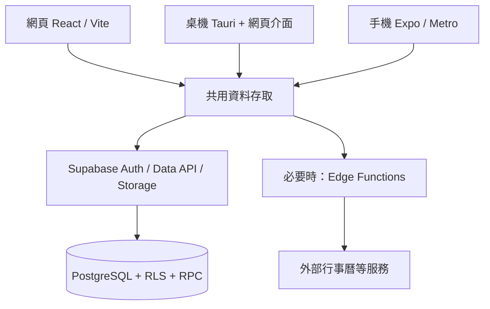

# 技術與架構方向

更新：2026-09-27。已確認：**專案服務不付費、資料庫使用 Supabase、採用完整 Vite 生態（含 Oxc）**。使用者已同意按建議方向執行，以下方案作為實作基線；尚未安裝或完成相容性驗證。

## 這次調整

原草案使用 NestJS + Prisma + 獨立 API／worker。為減少零預算下的託管與維護負擔，已決定由 Supabase 承擔第一版資料、身分與附件服務，必要時使用資料庫函式或短時間 Edge Functions。NestJS 與 Prisma 留作未來需求明確時再評估的替代方案。

免費限制、配額與費用邊界見[免費服務](free-services.md)，工具細節見[Vite 工具鏈](toolchain.md)。免費是服務選型限制，不表示任何供應商承諾永久無限額度。

## 組合與取捨

| 層次 | 目前方向 | 理由與限制 |
|---|---|---|
| 語言／工作區 | TypeScript + pnpm workspace | 共用領域規則與資料存取；版本在 M0.5 鎖定 |
| 工具鏈 | 優先 Vite+；Vite／Rolldown／Oxc、Oxlint、Oxfmt、Vitest，按需 tsdown／Vite Task | 採同一生態的建置、品質與測試工具；整合版相容性先驗證，不靠付費服務 |
| 網頁 | React + Vite + Tailwind CSS | 靜態應用連 Supabase；不需要常駐 Node 伺服器 |
| 驗證與伺服器狀態 | Zod + TanStack Query | schema 驗證、快取與查詢更新；不取代 RLS、交易或衝突處理 |
| 桌機 | Tauri + 同一份網頁介面 | 原生打包仍使用 Rust／Cargo；先本機自用，公開簽章與發布另定 |
| 手機 | React Native + Expo development build | 原生 bundle 仍用 Metro；Vite 不取代 Expo 的平台建置流程 |
| 資料庫 | Supabase Free 的 PostgreSQL（已指定） | SQL migration、關聯約束、版本欄位；不依賴付費 database branching |
| 資料存取 | supabase-js + Data API，必要原子寫入用 Postgres RPC | 以 RLS、約束與交易維護資料；前端驗證不能作為唯一防線 |
| 登入／附件 | Supabase Auth + Storage Free | 使用相同服務降低維護成本；登入寄信與檔案配額需另外處理 |
| 伺服器邏輯 | 優先資料庫函式；需要私密憑證或第三方交換時才加 Edge Functions | 不把 Edge Functions 當常駐程序或長時間背景 worker；需驗證執行限制 |
| 筆記 | Markdown 內容與獨立連結關係（初期支援子集見決策紀錄） | 編輯器、中文輸入與匯入匯出先試做 |
| 搜尋／圖譜 | PostgreSQL 查詢／關係索引；呈現套件後選 | 不新增付費搜尋或圖形資料庫；中文搜尋與節點量需驗證 |
| 測試 | Vitest：領域與網頁；Playwright：網頁流程；SQL／RLS 整合驗證；手機真機 | 不再預設 Jest 為全專案主測試工具；React Native 元件測試仍需另驗證相容性 |
| 網頁部署 | Cloudflare Pages Free 靜態託管與平台網址 | 不購買網域；建置與其他資源依免費限制使用 |
| 建置與備份 | 本機建置、本機匯出；雲端 CI 若使用則限制免費額度 | 不要求付費 EAS、雲端快取或付費備份產品 |

供應商能力依據：[Supabase RLS](https://supabase.com/docs/guides/database/postgres/row-level-security)、[Edge Functions 限制](https://supabase.com/docs/guides/functions/limits)、[Expo Metro](https://docs.expo.dev/guides/customizing-metro/)、[Tauri 架構](https://v2.tauri.app/concept/architecture/)。具體選型與邊界是本專案提案。

程式碼規範：採 SOLID、每個程式檔最多 600 行（測試與純樣式檔除外）；詳見[程式碼規範](coding-standards.md)。工具採維護中的主流穩定方案，新增依賴依實際需求。

## 共用邊界



三端共用 TypeScript 領域規則、資料型別與資料存取；手機和 Web 各自處理操作介面。Vite+ 管理可支援的開發工作，不接管 Expo 原生打包、Tauri Cargo 或 Supabase 的 Deno 執行環境。

簡單 CRUD 走受 RLS 保護的 Data API；例如「取消時段並同步更新相關記錄」的多表寫入，放在原子 RPC／交易內。安全性與持久化規則必須由資料庫或伺服器端驗證。實作前需測試直接呼叫 API 也不能繞過規則。

## 未來目錄藍圖

```text
apps/
  web/             Vite 網頁與桌機共用介面
  mobile/          Expo 手機應用
  desktop/         Tauri 平台容器
packages/
  domain/          純 TypeScript 領域規則
  data-access/     Supabase 存取與衝突處理
  contracts/       應用契約；資料庫型別由 schema 產生
supabase/
  migrations/      SQL、RLS、資料庫函式
  functions/       有需求才建立 Edge Functions
  tests/           資料庫、權限與交易驗證
```

先建 M0.5 需要的最小切片，其餘有實際使用時再新增。各平台共享程式需避免 Node-only API；使用 tsdown 打包共用套件時也要驗證 Expo 的消費端相容性。

## 資料與同步

- Supabase schema 以儲存庫中的 migration 為準，避免只在 Dashboard 手動改表。開發／驗證優先使用本機環境，不為每張任務卡開一個雲端專案。
- 建議使用 supabase-js 的使用者 session 與 publishable key；公開 schema 的表啟用 RLS，以使用者身分限制資料。service-role／secret key、資料庫密碼和第三方密鑰只留在可信任環境，不打包進任何客戶端。
- 多表操作由 RPC／交易保障一致性，新增／重試以唯一約束或冪等識別避免重複。RLS、函式權限與資料所有權納入驗收。
- 筆記帶版本號。更新應以「ID＋預期版本」為條件原子寫入，失敗時保留未送出內容並提示衝突；不採靜默 last-write-wins。
- 初期在開啟、前景切回、寫入後與手動重新整理取得最新資料。Realtime 可作後續更新提示，不是已完成的同步解法；使用前評估免費連線／訊息配額。
- 不需要離線編輯；網路、暫停或配額限制時顯示服務不可用，不能把資料缺失變成零。斷線停用編輯並保留當前未送出的草稿，重連確認後再提交；不提供離線編輯佇列。
- 依免費方案自行匯出備份，資料庫與 Storage 附件分別處理，M1 就設計還原路徑；詳細限制見免費服務文件。

## 課表、歷史與時間

- 分開保存固定時段、當日時段／異動與執行紀錄，避免把「計畫」與「實際」混成同一筆。
- 建議週課表使用帶生效日期的版本；歷史日期使用當時適用版本，單日異動獨立保存。
- 固定每週時間保存當地牆鐘時間與 IANA 時區；具體事件另有可比較的時間點。不能只存 UTC 小時就推算所有未來週期。
- 跨午夜、旅行與日光節約時間採[Q03 預設](open-questions.md)：固定排程時區、預設 Asia/Taipei、時段歸開始日；以測試驗證邊界。
- 提醒識別需關聯「當次安排＋提醒種類＋版本」。改時、取消與重新同步時撤銷過期提醒。
- 分析不把空值當零；取消、待補記與完成率分母依[Q13](open-questions.md)的記錄率／已記錄完成率定義驗證。

## 通知、Widget 與步數

提醒能力要在 M0 做真機小驗證。Expo 提供排程與處理通知的 API；使用 development build 驗證正式需要的原生能力，不能只以 Expo Go 結果判定可行。[Expo Notifications](https://docs.expo.dev/versions/latest/sdk/notifications/)

初步候選是手機本機排程負責近期提醒，Supabase 保留提醒設定與必要的同步狀態；多裝置補發與遠端推播延後評估，不把常駐付費 worker 列為前置條件。不要讓兩個來源同時對同一提醒發送。驗證 App 在背景、關閉、重新開機、裝置省電、權限拒絕與跨裝置改時的行為；不承諾所有系統狀態下精準到秒。

Widget 是平台功能，不能把一般 React 畫面直接當成桌面 Widget。先以 Android 的目前／下一時段與開啟項目入口驗證更新限制、資料新鮮度與權限，再決定可直接完成哪些操作。[Android App Widgets](https://developer.android.com/develop/ui/views/appwidgets/overview)

Android 每日步數採 Health Connect，手機在授權後讀取並同步摘要；彙總策略須處理來源重疊，沒有授權或沒有資料時顯示不可用而非零。iOS 健康資料不自動視為本輪範圍。[Health Connect 彙總讀取](https://developer.android.com/health-and-fitness/health-connect/aggregate-data)

外部行事曆優先驗證一個來源，已採 Google Calendar；採適合功能的唯讀 scope，不實作外部寫入。來源刪除／改期後，如何反映本地衝突與提醒，要補進驗收。[Google Calendar scopes](https://developers.google.com/workspace/calendar/api/auth)

## 開工前的小驗證

1. 選定相容的 Vite+／Vite／React／Node 版本，跑通檢查、Vitest 與建置；若整合入口不合，採相同生態的獨立工具，保留使用者的工具鏈要求。
2. 本機 Supabase migration 重建成功；以兩個測試使用者驗證互相不可讀寫；RPC 拒絕越權與過期版本寫入。
3. 在免費方案內驗證登入、資料保存、兩端讀取與衝突；不依賴付費備份或常駐 API。
4. 真機驗證通知、Widget、步數授權與資料缺漏；失敗時記錄限制，不先擴大平台承諾。
5. 以小量筆記與附件跑一次匯出／還原，核對檔案與連結。

架構與服務方向已確認，重大取捨記錄於 [ADR-0001](adr/0001-supabase-free-backend.md)；相容版本仍需驗證。尚未建立雲端資源或安裝套件。
